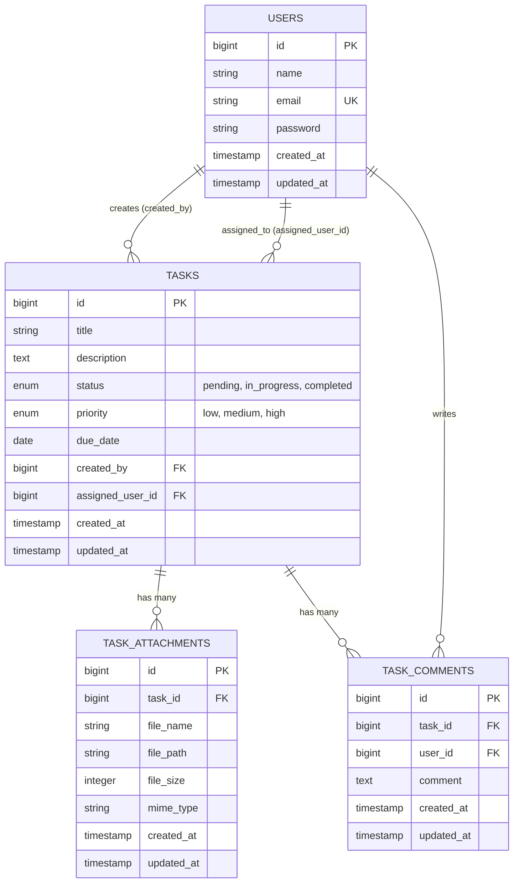

# System Architecture & Design

Dokumen ini menjelaskan rancangan arsitektur, pola desain, alur data, dan relasi database untuk aplikasi **Task Management System Fullstack**.

---

## 🏛️ Arsitektur Tingkat Tinggi (High-Level Architecture)

Aplikasi dirancang dengan pola **Decoupled Client-Server (SPA + RESTful API)**:

```
+-------------------------------------------------------------+
|                 Frontend Client (Vue 3 SPA)                 |
|  - Vuetify 3 (UI Components)                                 |
|  - Pinia (State Management: Token & Auth State)             |
|  - Vue Router (Navigation & Route Guards)                   |
|  - Axios (HTTP Client)                                      |
+------------------------------+------------------------------+
                               |
                        JSON / REST API
                       (Bearer Token Auth)
                               |
+------------------------------v------------------------------+
|                 Backend Server (Laravel 12)                 |
|  - Routing (routes/api.php)                                 |
|  - Controllers (AuthController, TaskController, etc.)       |
|  - Middleware (Sanctum Token Authentication)                |
|  - Eloquent ORM (Data Access Layer)                         |
|  - Storage Disk (Public storage for attachments)            |
+------------------------------+------------------------------+
                               |
                       SQL Queries / PDO
                               |
+------------------------------v------------------------------+
|                    Relational Database                      |
|  - MySQL / MariaDB / SQLite                                 |
+-------------------------------------------------------------+
```

---

## 🗄️ Skema Database & Relasi Model

Sistem data berpusat pada entitas **Tasks**, **Users**, dan **TaskAttachments**:



### Relasi Eloquent
1. **User - Task**:
   - `User->tasks()`: Tugas yang dibuat oleh pengguna (`created_by`).
   - `Task->creator()`: Mengembalikan user pembuat task (`belongsTo(User::class, 'created_by')`).
   - `Task->assignedUser()`: Mengembalikan user yang ditugaskan (`belongsTo(User::class, 'assigned_user_id')`).
2. **Task - Attachment**:
   - `Task->attachments()`: Berkas-berkas pendukung terkait task (`hasMany(TaskAttachment::class)`).
   - `TaskAttachment->task()`: Task induk (`belongsTo(Task::class)`).
3. **Task - Comment**:
   - `Task->comments()`: Komentar/diskusi di dalam task (`hasMany(TaskComment::class)`).

---

## 🔐 Alur Autentikasi (Authentication Flow)

Autentikasi menggunakan **Laravel Sanctum Token Authentication**:

1. Pengguna memasukkan `email` & `password` di form login Vue (`/login`).
2. Request `POST /api/auth/login` dikirim ke backend.
3. Backend memverifikasi hash password, lalu menerbitkan `access_token` plain text via Sanctum.
4. Frontend menyimpan token ke `localStorage` dan ke state Pinia (`authStore.token`).
5. Setiap request API berikutnya menyertakan header:
   ```http
   Authorization: Bearer <access_token>
   ```
6. Saat logout (`POST /api/auth/logout`), token dihapus dari database dan `localStorage` dibersihkan.

---

## 📂 Manajemen Lampiran Berkas (File Attachments)

- File diunggah sebagai format `multipart/form-data` melalui `POST /api/tasks/{task}/attachments`.
- Backend memvalidasi ukuran maksimum (50 MB) dan menyimpan berkas di disk `storage/app/public/attachments`.
- Metadata (nama asli, ukuran, path, MIME type) disimpan di tabel `task_attachments`.
- Download dilakukan melalui streaming `BinaryFileResponse` via endpoint publik `GET /api/attachments/{attachment}/download`.
- Ketika attachment dihapus (`DELETE /api/attachments/{attachment}`), file fisik di storage otomatis dibersihkan oleh `Storage::disk('public')->delete(...)`.
